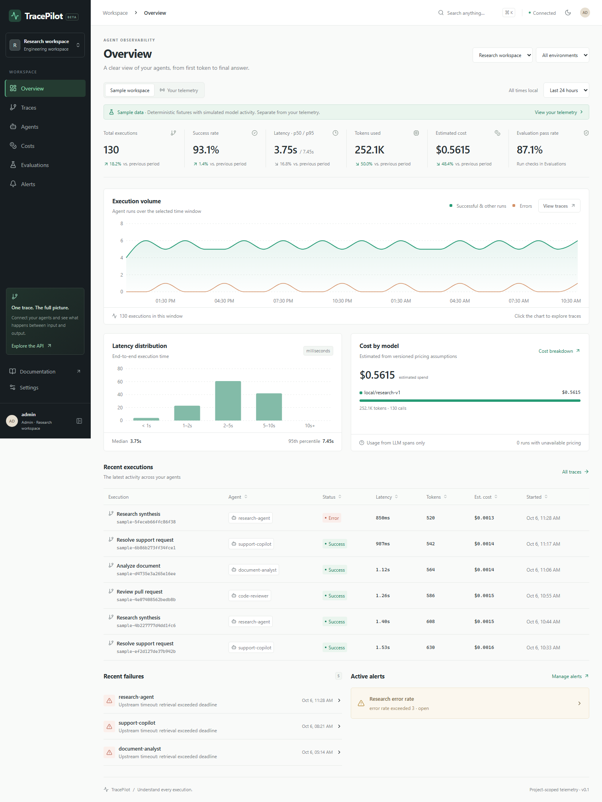
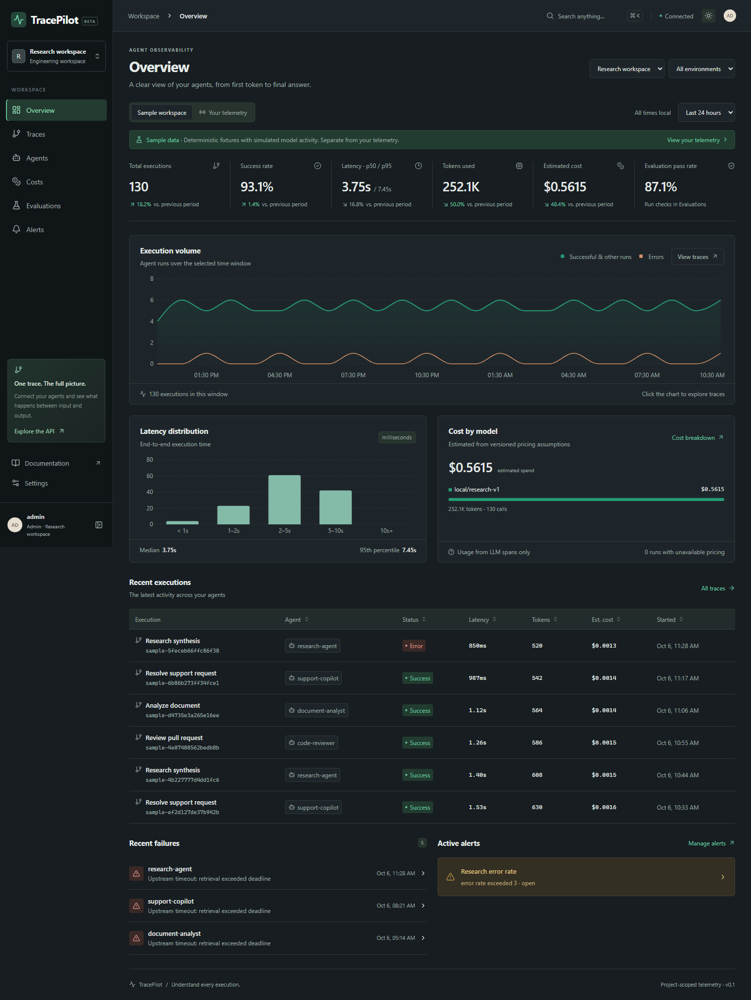
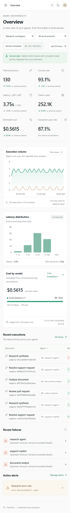
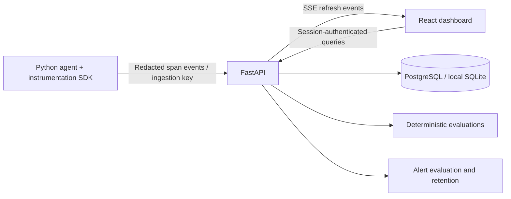

# TracePilot

**Understand every agent execution, from first span to final answer.**

TracePilot is a full-stack observability dashboard for inspecting agent executions, LLM calls, tool activity, latency, estimated costs, and deterministic quality checks. It includes a Python instrumentation SDK and a runnable research agent.

> Working local application. Sample data is clearly labeled and separate from real telemetry. This project does not claim production readiness; see [limitations](#remaining-scope-and-limitations).



[Getting started](#start-locally) · [Docker setup](#postgresql-and-docker-compose) · [Walkthrough](#reproducible-walkthrough) · [Architecture](#architecture-and-data-semantics) · [Verification](VERIFICATION.md)

## Features

- **Execution overview:** backend-derived run counts, success rate, latency percentiles, tokens, estimated costs, evaluation results, and failures.
- **Trace explorer:** search, URL-persisted filters, sorting, pagination, column visibility, and authorized CSV export.
- **Span inspection:** nested span relationships, synchronized waterfall, redacted attributes, usage, exceptions, and shareable deep links.
- **Costs and evaluations:** versioned pricing assumptions, unavailable-price handling, and per-case deterministic quality checks.
- **Alert workflows:** configurable thresholds, lookback windows, minimum samples, incident deduplication, acknowledgment, and resolution.
- **Project access:** Admin, Developer, and Viewer roles; hashed ingestion keys; revocation; retention; and browser notification preferences.
- **Responsive workspace:** graphite navigation, emerald accents, light/dark themes, mobile navigation, and reconnecting SSE updates.

## Screenshots

All screenshots show the application's explicitly labeled sample workspace, using deterministic fixtures and simulated model activity.

<details>
<summary><strong>Dark theme</strong></summary>



</details>

<details>
<summary><strong>Mobile layout</strong></summary>



</details>

## Technology

| Layer | Stack |
| --- | --- |
| Frontend | React, TypeScript, Vite, React Router |
| UI | Tailwind CSS, Radix/shadcn-style primitives, Lucide, Sonner |
| Data and charts | TanStack Query, TanStack Table, Recharts |
| API | FastAPI, Pydantic, SQLAlchemy, Alembic |
| Storage | PostgreSQL in Docker; SQLite for local development |
| Live updates | Server-Sent Events with reconnect handling |
| Verification | pytest, Vitest, Playwright |

## Start locally

Requirements: Node 22+ and Python 3.10+. Commands below use PowerShell in this repository.

```powershell
npm ci
python -m venv .venv
.\.venv\Scripts\python -m pip install -r backend/requirements.txt
$env:ADMIN_EMAIL = 'admin@tracepilot.local'
$env:ADMIN_PASSWORD = 'choose-a-long-local-password'
.\.venv\Scripts\python -m alembic upgrade head
.\.venv\Scripts\python -m backend.bootstrap
# Optional: 240 deterministic sample traces, explicitly separated from telemetry.
.\.venv\Scripts\python -m backend.seed
.\.venv\Scripts\python -m uvicorn backend.main:app --host 127.0.0.1 --port 8000
```

In a second terminal, run `npm run dev`. Open **http://127.0.0.1:5173** and sign in with the bootstrap credentials. The API and interactive OpenAPI documentation are at **http://127.0.0.1:8000/api/docs**. On macOS/Linux, substitute `.venv/bin/python` and export environment variables.

Bootstrap never overwrites an existing administrator password. The API never auto-creates accounts or seeds data. Choose your own administrator password of at least 12 characters; there is no published default login password.

For macOS/Linux:

```bash
npm ci
python3 -m venv .venv
source .venv/bin/activate
pip install -r backend/requirements.txt
export ADMIN_EMAIL=admin@tracepilot.local
export ADMIN_PASSWORD='choose-a-long-local-password'
python -m alembic upgrade head
python -m backend.bootstrap
python -m backend.seed  # optional
python -m uvicorn backend.main:app --host 127.0.0.1 --port 8000
# In a second terminal: npm run dev
```

## PostgreSQL and Docker Compose

```powershell
Copy-Item .env.example .env
# Edit ADMIN_PASSWORD and POSTGRES_PASSWORD in .env.
docker compose up --build -d
docker compose exec api python -m backend.seed  # optional
```

Compose starts PostgreSQL, runs Alembic and bootstrap, then serves the built frontend through Nginx with same-origin API/SSE proxying. Use http://127.0.0.1:5173. Ports bind to loopback. The database persists in a named volume. `docker compose down` preserves it. For an HTTPS deployment, set the exact `APP_ORIGIN`, enable `COOKIE_SECURE=true`, and configure TLS at your reverse proxy. `.env` is read by Compose; direct local Python execution uses process environment variables.

Docker Desktop's daemon was unavailable in the implementation environment. Compose has been configuration-validated; PostgreSQL/container execution has **not** been verified here. The tested running preview uses SQLite.

## Reproducible walkthrough

1. Sign in. The overview starts in **Sample workspace**, with an explicit simulated-data banner. Switch to **Your telemetry** to see the separately ingested stream.
2. Open **Settings → Create key**. Copy the raw key once; it cannot be recovered later.
3. In a terminal:

   ```powershell
   $env:TRACEPILOT_API_KEY = 'paste-your-key'
   .\.venv\Scripts\python -m examples.research_agent
   ```

4. Select **Your telemetry**, **All environments**, **Last 24 hours**. The example appears as `research-agent` in development. It performs real local retrieval/tool work and emits start/completion events; its LLM activity and token counts are explicitly simulated.
5. Open its trace. Select agent, retrieval, tool and LLM spans in the waterfall. Copy IDs/deep links; inspect redacted attributes, UTC timestamps, model usage and estimated span cost.
6. In **Traces**, filter/search, sort, hide columns, paginate and export CSV. Filters persist in the URL. The export uses the same server-side filters and project authorization.
7. In **Evaluations**, run deterministic checks for the current source/time/environment filters. Inspect a case. Missing assertions remain unavailable, not fabricated scores.
8. In **Alerts**, create a rule with a threshold, lookback, minimum samples and environment. Open incidents are deduplicated; acknowledge them, or disable/edit the rule to resolve a cleared condition.
9. Add a Viewer or Developer in **Settings** and sign in as that account to exercise server-enforced roles. Revoke the ingestion key and confirm subsequent SDK writes return 401.

Optional real-provider execution:

```powershell
$env:OPENAI_API_KEY = 'your-provider-key'
$env:OPENAI_MODEL = 'your-enabled-model'
.\.venv\Scripts\python -m examples.research_agent --provider openai
```

This adapter calls the provider from Python only. It was not live-tested because no provider credential was supplied. Unknown model pricing displays **Unavailable**, never zero. Do not put secrets in `VITE_` variables.

## Architecture and data semantics



- `src/App.tsx`: authenticated workspace shell, router, URL filters, theme, search and SSE refresh/reconnect status.
- `src/pages.tsx`: overview, trace explorer/waterfall, agent/version comparison, costs, evaluation cases, alert rules/incidents, project/member/key settings.
- `src/components/ui.tsx`: accessible Radix dialog and dropdown primitives, shared button/status/loading/error states, following shadcn's compositional pattern.
- `backend/main.py`: versioned ingestion, session authentication, project authorization, query/export APIs, settings and deterministic evaluation execution.
- `backend/analytics.py`: filtered aggregation, trace assembly, pricing and percentiles. Only LLM spans contribute token/cost totals.
- `backend/db.py`: indexed project-scoped spans and typed JSON records for projects, users, sessions, keys, pricing, rules, incidents, datasets and evaluations.
- `backend/migrations`: reversible initial Alembic schema migration.
- `sdk/tracepilot.py`: synchronous context-manager instrumentation with idempotent bounded retries. Run from the repository; it shares redaction with the backend and is not yet a separately published package.
- `examples/research_agent.py`: offline deterministic provider plus optional OpenAI adapter. Output schema validation occurs in the instrumented process before raw output is discarded.

Span schema `1` includes project/trace/span/parent IDs, type, agent/version, environment, aware timestamps, lifecycle status, revision, model/provider, usage, source and redacted attributes. Timestamps normalize to UTC. Span IDs are unique per project. Higher revisions update a span; older or duplicate revisions are no-ops. Parents may arrive after children, with cycle detection and immutable trace context. Incomplete traces remain inspectable. Parallel intervals are positioned by absolute timestamps; cancelled/error spans and retry revisions remain visible.

The SSE endpoint revalidates session and membership on each heartbeat and asks the browser to refetch every ten seconds. EventSource reconnects with a five-second retry. This is a refresh stream, not a durable event log; reconnection obtains current database state.

Overview comparisons use an equally sized preceding window. Latency is completed root-span elapsed time. Success rate excludes running traces and includes cancelled traces as non-success. Token totals are leaf LLM-reported usage, not parent totals. The local provider reports deterministic fixture counts, not measured tokenizer counts. Cost is an estimate from the latest applicable stored pricing version. The built-in local rate is illustrative, not a live provider quote. Aggregate spend may be partial when some traces have unavailable pricing; the overview reports the unknown count. Agent version comparisons use the same selected window.

Evaluation records preserve run ID, dataset version, agent version, method and per-case results. Citation, schema and tool checks evaluate SDK-produced assertions; latency uses the stored duration. They are not an independent factuality assessment. No LLM-as-judge or invented quality scores are present.

## Security decisions

- Argon2 password hashing; opaque random sessions stored only as SHA-256 hashes, 12-hour expiry, HttpOnly/SameSite=Strict cookies, explicit trusted-origin validation for browser mutations.
- Admin: project settings, member creation and ingestion keys. Developer: reads, evaluations, rule edits and acknowledgment. Viewer: reads and exports only. Every project route, trace detail, CSV export and SSE stream enforces membership on the server.
- Ingestion keys are random, stored as hashes and scoped to a project. They cannot read data or authenticate browser sessions. Revocation takes effect at the next request.
- SDK and ingestion API redact sensitive attribute keys recursively, including prompt/input/output/content/message/query/response fields, credentials and email-like content. Raw prompts are not stored by default. Redaction is heuristic, not a complete DLP guarantee; instrumentors must avoid sensitive content in names and arbitrary metadata.
- Source labels are isolated query domains within a project. The API rejects mixed source/environment/agent context within one trace.
- CSV formula-prefix escaping protects exported text. Project-scoped retention deletes expired spans on settings save and in the 30-second maintenance loop.
- No provider credentials are bundled into frontend code. No outbound notification messages are sent. The notification preference controls browser toast notifications for open workspace incidents.

## Verification

```powershell
npm run build
npm test
npx playwright install chromium
$env:ADMIN_PASSWORD = 'your-bootstrap-password'
npm run test:e2e  # requires seeded API + frontend on 8000/5173
.\.venv\Scripts\python -m pytest backend/tests -q
npm audit
```

Playwright requires `ADMIN_PASSWORD` and uses `admin@tracepilot.local` as the test administrator. It tests filtering, trace inspection, alert persistence, recoverable API errors, permissions, key revocation, cost grouping, evaluations, and responsive navigation. Run it against a disposable local database: browser scenarios create test accounts, rules, keys, and evaluation records. Screenshots are written to ignored `artifacts/`; curated README images live in `docs/screenshots/`. Backend tests use an isolated in-memory database and do not mutate the preview database. `src/api.test.ts` verifies unavailable/zero/incomplete display semantics.

Actual results and environment limits are recorded in [VERIFICATION.md](VERIFICATION.md).

## Remaining scope and limitations

This is a functional local application, **not a production-readiness claim**.

- Aggregation currently assembles project spans in application memory. Larger deployments need SQL aggregation, bounded ingestion throughput, rate limiting, background workers, load tests and operational monitoring.
- The maintenance task assumes a single API worker. Multi-worker incident creation needs database-level uniqueness/locking or a dedicated scheduler. Budget rules use known estimated costs; unknown pricing can understate spend.
- Agents are discovered from telemetry rather than a separately managed registry. Version comparisons include runs, error/success rates, latency and cost, but dedicated time-series trend views are not implemented.
- One built-in versioned evaluation dataset is available. Dataset upload/editing, independent replay, evaluation pagination and optional LLM judging are not implemented.
- Pricing versions are stored server-side; a pricing-management UI is not implemented. Add verified assumptions through a migration/bootstrap extension rather than treating illustrative sample rates as provider pricing.
- Membership creation supports new local accounts. SSO, invitation delivery, password recovery, role changes/removal, per-user notification preferences and audit logs are not implemented.
- Alerts use configured lookback windows, independently of the dashboard time filter. External email/webhook notification delivery is not implemented. Alert source/environment selection is respected.
- Retention currently covers spans; evaluation and incident records are retained. No remote agent cancellation or retry command is exposed; the UI represents the statuses and revisions supplied by instrumentation.
- The browser tests cover Chromium, not a full browser/device/accessibility matrix. No external penetration test, PostgreSQL load test, provider integration test or hosted deployment was performed.

Reference APIs: [FastAPI security documentation](https://fastapi.tiangolo.com/tutorial/security/oauth2-jwt/) and [TanStack Table v8 installation/compatibility](https://tanstack.com/table/v8/docs/installation).
